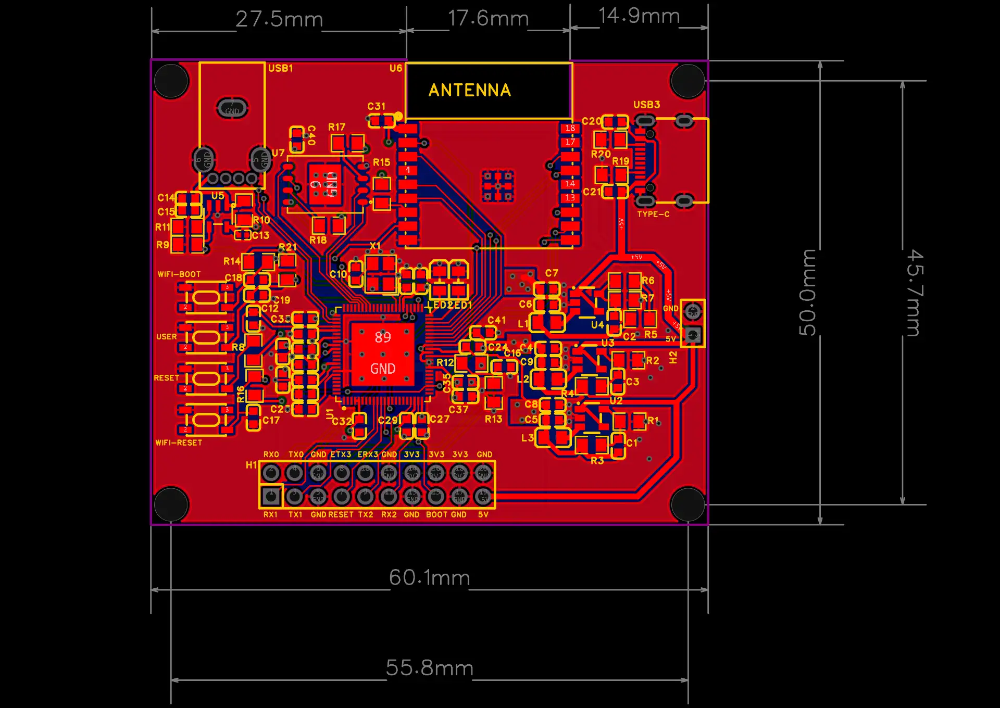
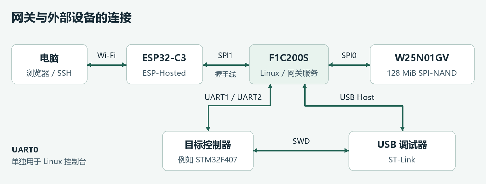
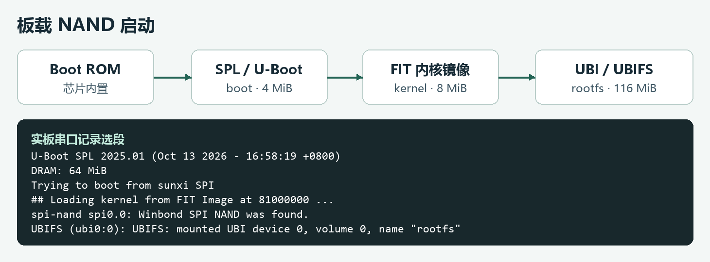
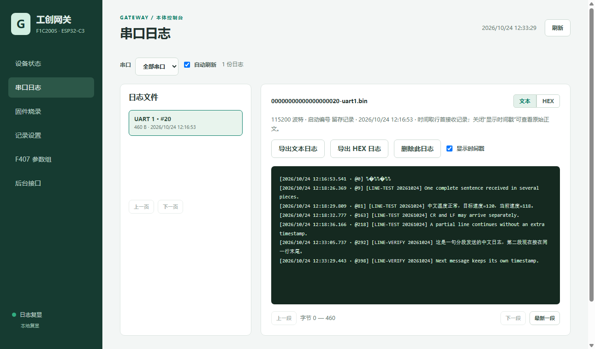
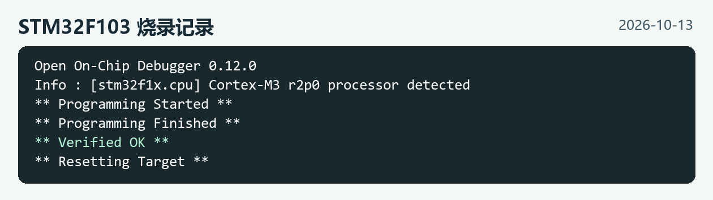

# F1C200S Linux 无线调试与 AI 协作网关

这是一块面向嵌入式开发、设备维护和自动化测试的 Linux 无线调试网关。板上用全志 F1C200S 运行 Linux，ESP32-C3 负责接入 Wi-Fi，系统和日志放在板载 SPI-NAND 上。电脑通过局域网访问它，就可以查看串口日志、管理固件和参数，也可以经网关上的 ST-Link 给目标板下载程序。

我希望把它做成一个可以持续扩展的设备端工具节点：人通过网页操作，脚本通过命令行或接口调用，AI 编程助手也能经 SSH 参与调试。串口记录、固件下载和参数管理是已经实现的应用，Linux 的进程、文件、网络和驱动机制则为后续增加工具与服务提供基础。



*图 1 网关 PCB 工程预览。主控在中部，ESP32-C3 模组靠板边布置，右侧是电源部分。此图为工程预览。*

## 1 把调试工具放到设备一端

嵌入式调试经常要在串口终端、下载工具、参数软件和测试脚本之间来回切换。设备离电脑稍远，反复搬动、插线和重新连接就会打断测试；出现异常时，也未必留下了当时的完整数据。

这个网关把通信、记录和调试入口放到设备附近。网关持续接收并保存目标设备输出，电脑需要时再通过网络读取；固件文件先传到网关，再由本地工具执行下载和校验。即使暂时关闭浏览器，独立的日志服务仍可继续工作。

在此基础上，可以接入不同单片机、带串口的设备或支持相应 Linux 驱动的 USB 调试器，并按需求编写协议解析、数据处理和自动化脚本。目标设备的状态与参数通过它自己的协议接入，网关侧的工具和界面也可以继续扩充。

### 当前功能

| 类别 | 提供的能力与使用条件 |
| --- | --- |
| 独立运行 | 从板载 SPI-NAND 启动 Linux，自动启动相关服务 |
| 无线接入 | ESP32-C3、2.4 GHz Wi-Fi、DHCP 获取地址；可保存多个网络，重新连接时按配置选择 |
| 自动发现 | mDNS、局域网主机名、UDP 发现和 Windows 发现脚本 |
| 网页管理 | 查看运行状态、串口日志、存储和 USB 状态，管理固件及参数组 |
| SSH 与自动化 | 密钥登录、命令行和文件传输；Web、CLI 和脚本共用后台 |
| AI 协作调试 | 电脑端 AI 经 SSH 调用网关工具，获取日志与结构化结果，参与固件迭代、参数调整和测试分析；已有项目使用记录 |
| 双路串口 | UART1、UART2 分别保存接收原始字节，不依赖浏览器保持打开 |
| 日志查看和导出 | 文本、HEX、时间戳显示及整份导出；保留原始数据和接收块时间索引 |
| 日志保留 | 按文件数或总容量清理，也可手动导出和删除指定文件 |
| 固件下载 | USB Host 接 ST-Link，由 OpenOCD 执行下载、校验和复位；已做 F103、F407 联调 |
| 烧录留档 | 记录文件名、目标、SHA-256、时间、执行结果及工具输出 |
| 辅助控制 | 目标 NRST、BOOT0 和 USB 对外供电开关；使用前核对目标板接线与电平 |
| 目标通信 | 请求应答、状态缓存、参数读写和参数组保存；目前使用专用目标协议适配器 |
| 运行诊断与恢复 | 网络、串口、USB 和存储诊断，服务监督、Wi-Fi 恢复及系统看门狗 |

## 2 AI 如何通过网关参与真实硬件调试

与 AI 交互是我做这个网关时很看重的一部分。在前面的项目调试里，我已经多次让电脑端的 Codex 通过它操作真实硬件：我说明想验证的功能、遇到的现象和现场观察，AI 阅读源码与已有记录，通过 SSH 调用网关上的命令，再根据返回的日志、参数和测试结果继续分析、修改与验证。

AI 的分析和代码构建在电脑或配套编译环境中进行，F1C200S 提供持续在线的 Linux 工具环境，以及通往目标硬件的通信和调试链路。这样，AI 生成的修改有了实际部署和获取反馈的入口，我也可以把现场测量、照片或视频补充进去，让下一轮调整有依据。

### 一次交互是怎样完成的

1. 我提出任务，例如检查串口异常、调整某个参数，或验证一版新固件。
2. AI 先读取源码、网关状态和目标回包，确认当前版本、连接情况及已有结果。
3. AI 在电脑端修改和构建程序，或生成本轮所需的测试脚本、配置和数据处理命令。
4. 通过 SSH、网关 CLI 或后台接口，把固件或命令交给设备端执行。
5. 网关返回工具输出、结构化结果和原始串口记录，AI 据此核对执行结果；我补充实际现象和测量。
6. 根据这一轮结果继续调整，保留对应的固件校验值、参数与测试记录，方便复现和回退。

### 项目中已经实际用过的方式

| 调试任务 | AI 通过网关做了什么 | 如何核对结果 |
| --- | --- | --- |
| 固件迭代 | 修改并构建固件，传到网关，经 ST-Link／OpenOCD 更新目标控制器 | 检查下载任务、校验与复位输出，再读取目标版本和后续运行数据 |
| 参数调整 | 读取原参数，写入 RAM 参数，再读回比较；测试后恢复原值 | 留有参数写入、读回和回退记录，保存参数组与写入目标分开执行 |
| 传感器与反馈采集 | 调用目标协议读取编码器、双 IMU 和运行状态，持续保存回包 | 一轮 20 秒联合测试保存了两路编码器反馈，MPU6050 与 BMI088 在该轮约为 100 Hz |
| 根据实测继续调试 | 根据我反馈的实际行程计算比例修正，下发并读回，再安排下一轮验证 | 把现场测量与目标遥测一起看，之后继续做直线、往返及多点巡航测试 |
| 运行状态排查 | 读取网关网络、服务、USB、内存和日志，区分设备异常与电脑访问路径问题 | 根据具体返回和复测结果定位，再确认修改是否生效 |

这些操作已经在目标控制器联调中使用。移动平台是其中一个应用案例，同样的“下发操作—读取反馈—继续分析”方式，也可以用于其他有明确通信协议和测试入口的设备。

### 接入方式与分工

网页、CLI 和自动化脚本复用网关后台，AI 可以直接使用命令与结构化返回。例如，在已建立的 SSH 会话里，可以从下面这些读取入口开始检查：

```sh
gateway status
gateway diagnose
gateway log uart1 --tail 4096
```

后续可以按目标设备增加新的 CLI 命令、协议适配器和测试脚本，让 AI 调用这些已有定义、可以检查结果的操作。现场使用时，我负责连接、测量和观察真实现象，AI 负责源码分析、工具调用与结果整理，网关负责执行设备端工具并保留数据。涉及实际动作的测试按确认的范围和时限执行，并在结束后核对停止状态。

我觉得这部分的价值，在于减少“复制串口输出给 AI、手动改代码、插线下载、再复制结果”的往返。AI 可以围绕实际设备数据参与多轮迭代，人在现场把关现象与效果，调试记录也能和每一版程序对应起来。

## 3 硬件是怎么组成的

主控用的是 F1C200S，ARM926EJ-S，QFN88 封装，封装内有 64 MiB DDR1。画板时省下了外置 DDR 的那一组走线，供电和初始化仍要处理。芯片外面配一颗 W25N01GV，容量 128 MiB，装引导程序、内核和根文件系统，也留空间存日志。工程最后采用单颗 SPI-NAND，因此还需要把这颗 NAND 上的整条启动链带起来。

| 部分 | 这块板上的配置 |
| --- | --- |
| 主控和内存 | 全志 F1C200S，封装内 64 MiB DDR1 |
| 系统存储 | W25N01GV，128 MiB SPI-NAND，接 SPI0 |
| 无线 | ESP32-C3-WROOM-02，SPI1 和握手线，ESP-Hosted |
| 串口 | UART0 留给 Linux 控制台，UART1 和 UART2 用于业务收发和记录 |
| USB 与供电 | USB-A 用于 Host 和调试器，Type-C 在本版接作供电输入 |

USB-A 的数据线接 F1C200S，给外设供电的 5 V 经过板上的电源开关。平时给板子供电走 Type-C，接下载器用 USB-A。H1 排针引出串口和目标控制线。我调启动时单独看 UART0，拿 UART1、UART2 接外部板或做回环，把 Linux 控制台输出和外部串口数据分开。

SPI0 用于 NAND，SPI1 留给无线模块。系统起来之后，设备树还得跟硬件连接对上。查某一路外设时，我会同时对照网表上的网络和设备树里的配置，先确认软件选的是板上那一组引脚。



*图 2 网关的硬件连接关系。UART 用于运行数据，ST-Link 通过 SWD 到目标板，NAND 留在网关本地。*

上电阶段，我把三路供电分开看。一次现场直流测量记录了 1.10 V、2.60 V 和 3.36 V，分别对应核心、DDR 与模拟、IO 三组电源的测试点。这些是当时的测量读数，复刻时应按原理图和器件要求检查供电。板子后来补焊过串口连接，确认 UART0 能实际收发，后续启动停在哪一步就可以直接从串口找。

## 4 从单颗 NAND 启动 Linux

这块板刚开始也是先借助 FEL，把维护程序放到板上跑，能读到主控和 NAND 以后再往下走。刚识别到内存时，先做小范围读写验证，后来再看 SPL 能不能带着后面的程序一起运行。最后在正常启动输出里看到了 64 MiB，接着 U-Boot 从 SPI-NAND 读出 FIT，Linux 识别存储并挂载 UBIFS。

SPI-NAND 有自己的页、擦除块和坏块处理。启动区需要符合 Boot ROM 读取方式的布局，编译出来的 U-Boot 文件还要经过打包。内核和设备树放进 FIT，根文件系统用 UBI 和 UBIFS。更新时按启动区、内核区和系统区分开处理，避免为了更新一处配置就覆盖存着日志的系统区。

单独的设备树文件便于检查外设配置，给 U-Boot 加载时还要把它和内核一起放进 FIT。应用日志按普通文件写进持久目录，由下层处理 NAND 的卷和坏块。系统、应用、配置和日志共用这颗 NAND，留给日志的空间要看实际余量。



*图 3 单 NAND 启动过程和串口记录选段。可以看到内存容量、FIT 加载和 UBIFS 挂载。*

一次启动整改中，发现旧 U-Boot 倒计时会被任意字符打断，空置串口接收脚也需要检查。后来给接收端补了上拉配置，把进入维护的条件改成完整字符串。更新启动和内核分区后逐字节回读，保留原来的 UBIFS 数据。重启时从串口发送普通字符，确认继续启动，最后能重新用 SSH 和网页连上。

## 5 ESP32-C3 联网与板上的网页

F1C200S 侧的 Linux 使用 ESP-Hosted 驱动，ESP32-C3 运行配套固件。两边通过 SPI1 传数据，另有握手和数据就绪信号。驱动起来后，Linux 出现无线接口，连接热点、获取 DHCP 地址和运行 HTTP 服务都沿用 Linux 的方式。

网关可以保存多个网络，重新建立连接时按配置选择，已经正常连接的网络会继续使用，失联后再重选。日志服务在系统启动后独立运行，热点还没连上时也能先收串口，把控制板刚启动时的输出留下来。

系统用 Buildroot 构建，板上运行 Linux 6.12.109，常用工具和网页服务使用 BusyBox。后台主要使用 C 和 Shell，界面交互放到电脑浏览器里。常规刷新读取周期更新的状态文件，需要详细诊断时再查询，减少反复扫描外设的开销。

网关获取地址后可以直接用 IP 打开，也可以用局域网 mDNS 名称或发现脚本查找。排查访问异常时，需要分别看无线关联、地址、板端 HTTP 服务和电脑请求路径。之前遇到过电脑代理导致域名请求返回 502，而设备本身可以直接访问的情况。

## 6 双路串口记录和导出

我比较看重的是日志能离开页面独立存下来。UART1 和 UART2 各有自己的记录，后台拿到什么字节就先保存什么字节。文本、协议帧和零字节都进原始文件，采集之后再选择怎么显示。有了原始数据，文本出现乱码时还能切 HEX 核对究竟收到了什么。

一份日志包含原始字节、时间索引和文件信息。索引记录接收块的偏移、字节数和接收时刻。刚开机未校时时可以看启动后时间，联网校时后也能按日期查询。这里的时间来自网关读到这块数据的时刻，目标板的采样时间仍应由目标板随数据发过来。

早期文本视图会把一句话拆成几段，中间插入多个时间。后来显示时改为按原始换行组织，同一句话分几次收到也保留在一行，取行首所在接收块的时间。原始字节和时间索引继续保留。网页可以切换文本和 HEX，也可以导出整份带时间的文件。



*图 4 用 10 月 24 日留存的数据在原网页上复显。几段分开收到的中文和英文按完整行显示；此图是留存数据复显。*

验证时，两路 UART 分别做过回环，对照发送和接收文件的校验值；关闭网页服务后，logger 继续接收，两路测试数据都按原样保存。整份 HEX 导出也做过还原，复原的 32 KiB 与测试原始数据一致。

日志会分段，保留策略支持按文件数或总容量清理。网页导出以打开文件时已经写下来的内容为准，活动日志之后可能继续增长。复盘时结合文件序号、启动编号和时间看，能把重启前后的记录分清楚。

## 7 用网页给外部板下载固件

调试器接到网关 USB Host，SWD 接目标板，下载时先把固件传到网页。后台检查文件格式、目标预设和地址范围，计算 SHA-256，再创建任务。真正的下载和读回由板上 OpenOCD 执行，页面显示任务状态和工具输出。烧录记录保留文件名、校验值和结果，方便回查当时使用的固件。

早期用 STM32F103 做过 PC13 呼吸灯固件联调。网关识别 ST-Link 后，OpenOCD 连接目标并执行擦写、校验和复位，留有程序读回记录，现场也观察到了呼吸灯运行。后来 F407 小车固件也通过这条 USB 和 SWD 路径下载和校验。接不同目标时，需要选择相应预设并确认接线。



*图 5 2026 年 10 月 13 日 F103 呼吸灯固件的 OpenOCD 记录，依次打印写入完成、校验通过和目标复位。*

网页还提供目标控制线操作。联调时分别确认 USB 调试器枚举、目标连接、固件校验和目标重新运行。复位控制线需要结合实际电平及目标响应判断，网页显示执行结果不等于每条控制线都已完成电气验证。

烧录任务在后台执行，提交后切换到串口日志页仍可观察目标输出。完成后用校验值把文件和任务记录对应起来。当前已有的实机链路以 ST-Link／OpenOCD 和相应 STM32 目标配置为基础，其他烧录方式需要另行适配。

## 8 实机应用案例

工创项目中的移动平台是我使用这个网关的一组实机案例。目标端为 F407，网关负责固件部署、协议交互和数据留存；目标控制器根据下发的配置完成采样、路径规划和运动控制。

网页和命令行都能读取目标状态与参数。参数组先保存在网关，写入目标是单独的操作；已有修改运行参数、读回核对并恢复原值的记录。串口 logger 在交互过程中继续保存原始通信数据，方便把一次修改和它对应的结果放在一起看。


*图 6 移动平台的场地联调照片，是网关的一组应用案例。*

这组调试从台架上的编码器和双 IMU 采集，推进到直线标定、往返、多方向与多点巡航，以及已知地图上的目标点规划。AI 通过网关完成多轮程序更新、参数调整和结果读取，我在现场观察实际轨迹并反馈现象。这里展示的是这套调试方法在一个具体系统中的使用过程。

## 9 Linux 带来的软件扩展空间

这块板运行的是可裁剪的 Linux 系统。现有网关应用可以继续修改，也可以在 Buildroot 中增加软件包、交叉编译工具、启动服务或新的网页接口，把它用于自己的设备和流程。扩展时可以围绕已有的 UART、USB 和网络能力展开：

| 扩展方向 | 可以继续开发的内容 |
| --- | --- |
| 自定义设备协议 | 增加串口帧解析、校验、请求应答、数据字段和设备状态显示，适配自己的控制器 |
| 协议转换与数据转发 | 按需要把串口数据送到 TCP／UDP、HTTP 或 MQTT 等上层通道，接入上位机或数据平台 |
| 自动化测试 | 编写批量采集、固件回归、参数遍历和结果对比脚本，让测试按约定流程执行并留档 |
| 更多烧录和调试工具 | 为相应 USB 调试器加入驱动及 ARMv5 可运行的工具，或继续接入 OpenOCD／GDB 调试流程 |
| 自定义网页与接口 | 增加设备面板、趋势显示、任务入口和数据导出，让人、脚本和 AI 使用同一套后台能力 |
| 设备维护与数据处理 | 增加日志分析、事件记录、定时任务、轻量数据处理和按需诊断服务 |

表中列的是可以继续开发的方向。具体落地需要配套的软件包、驱动、协议和测试；增加板上尚未引出的硬件接口时，也要重新核对引脚与电路。64 MiB 内存和板载存储适合围绕实际需求裁剪，优先放轻量工具与服务，较重的分析、编译和 AI 推理可以继续由电脑承担。

因此，复用时可以先采用现成的日志与下载功能，再逐步接入自己的协议和自动化任务。Linux 提供统一的工具运行环境，具体用途由应用软件决定，可以随着项目继续扩展。

## 10 工程资料与复刻说明

工程资料包括硬件设计、板级设备树、U-Boot 补丁、Buildroot 配置、网关应用和网页资源。看硬件可以从主控、供电、NAND 和无线几部分入手；看代码可以从 logger、网页后台和启动脚本顺着读。下面列出 GitHub 仓库里的源码和硬件工程，以及构建和复刻入口。

复刻时建议按下面的顺序推进：

1. 先核对原理图、PCB 版本和器件，检查供电，再通过 UART0 确认启动信息。
2. 按 SPI-NAND 的启动布局准备 SPL／U-Boot、FIT 和 UBI／UBIFS，分别核对启动区、内核区与系统区。普通文件系统压缩包或原始 U-Boot 文件不能直接当作整片 NAND 镜像写入。
3. 给 ESP32-C3 烧写匹配的 ESP-Hosted 固件，配置自己的网络和 SSH 公钥，再检查 Wi-Fi、DHCP 及网页访问。
4. 先用 UART1／UART2 回环确认串口记录和导出，再接目标控制器；按最新原理图、网表及目标板要求核对供电、共地、信号方向和电平。
5. 连接 ST-Link 和目标板，选对 OpenOCD 目标配置，再验证下载、读回及复位。读状态和调参数需要目标端实现对应协议。

目前已有独立启动、Wi-Fi、双路串口记录及 F103／F407 联调记录；网络重连和服务监督也有具体测试记录。整机长时间运行仍要继续积累结果，换控制板、供电或网络环境后需要重新检查相应链路。

把这块板写出来，主要是想交流做一套可扩展调试工具的过程。从 NAND 启动到串口落盘，从网页操作到 AI 通过 SSH 参与实机调试，这些功能逐步连在了一起。希望它能成为一个可以继续改造的 Linux 工具节点，给不同设备提供统一的调试、记录与自动化入口。

### 从哪里看

| 内容 | 入口 |
| --- | --- |
| Altium Designer 工程、原理图和 PCB | [Board1_1.PrjPcb](hardware/altium/Board1_1.PrjPcb) · [P1.schdoc](hardware/altium/Board1_1/Schematic1_1/P1.schdoc) · [PCB1_1.pcbdoc](hardware/altium/Board1_1/PCB1_1.pcbdoc) |
| 嘉立创 EDA 专业版源工程 | [F1C200S-gateway.epro](hardware/easyeda/F1C200S-gateway.epro) |
| Buildroot 板级配置、设备树、引导补丁和系统文件 | [buildroot-external](buildroot-external/) |
| 网关 C 后台、CLI、日志工具和测试 | [gateway-control](buildroot-external/package/gateway-control/) |
| 网页前端 | [www](buildroot-external/board/gateway/rootfs-overlay/www/) |
| ESP-Hosted 驱动与 ESP32-C3 固件配置 | [Linux 驱动](buildroot-external/vendor/esp-hosted-linux/) · [ESP32-C3](firmware/esp32-c3/) |
| 构建、NAND 镜像生成与验证 | [scripts](scripts/) |
| 硬件、软件与扩展说明 | [设计与调试记录](docs/gateway-design-and-extension.md) · [立创开源广场](https://oshwhub.com/a-ordinary-people/project_okgonhpw) |

AD 文件从同一版嘉立创工程导出。已核对工程引用、81 个 PCB 元件计数及 55 个网络名称。铜皮、钻孔、规则及焊盘几何仍要以嘉立创源工程和生产输出复核，详见[硬件说明](hardware/README.md)。

### 构建和首次配置

网关使用 Buildroot 2025.02.18、Linux 6.12.109、U-Boot 2025.01，目标为 ARM926 / ARMv5 EABI 软浮点。使用具备 [Buildroot 依赖](https://buildroot.org/downloads/manual/manual.html#requirement)的 Linux 主机，在仓库根目录执行：

```sh
./scripts/fetch-buildroot.sh
./scripts/build.sh f1c200s_gateway_defconfig
./scripts/build.sh
```

工具链、内核和用户空间第三方软件由 Buildroot 拉取。网关应用、板级配置和构建脚本保存在本库。ESP32-C3 的固件配套信息见[固件目录](firmware/esp32-c3/README.md)。

上电先核对接线和供电，从 UART0 检查启动。从板载 SPI-NAND 启动所需的 SPL/U-Boot、FIT 和 UBI/UBIFS 分开准备，布局由板级设备树和 `scripts/make-nand-images.py` 定义。根文件系统压缩包及普通 U-Boot 二进制各有用途，不能直接按整片 NAND 镜像写入。

初次配置建议在自己的调试网络进行。Wi-Fi 配置参见 `buildroot-external/board/gateway/rootfs-overlay/etc/gateway/wpa_supplicant.conf.example`，在自己的设备上填写网络信息。SSH 使用自己的公钥。常用本地检查入口在 `buildroot-external/package/gateway-control/tests/run-native.sh`，ARM 构建产物可用 `scripts/verify-build.sh` 进一步检查。

### 许可

硬件工程沿用立创项目的 GPL 3.0，见 [hardware/LICENSE](hardware/LICENSE)。网关 C 应用保留原有的 [MIT 许可](buildroot-external/package/gateway-control/src/LICENSE)，ESP-Hosted 和 cJSON 各自保留随源码提供的许可。Buildroot 获取的第三方软件继续适用其各自许可。

本文由 Codex 撰写，作者仅做审核、修改和发布。
