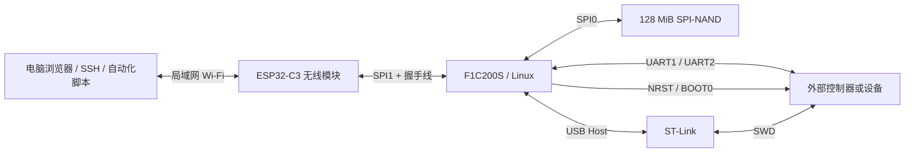

# F1C200S 无线调试网关

## 硬件、软件、功能与二次开发说明

**整理日期：2026-10-31**  
**硬件依据：2026-10-12 网关网表**  
**应用软件依据：当前 Gateway-Control 1.3.0 源码，API v1**

这是一份介绍设计和实现的技术资料，供后续整理开源项目时取用。内容只围绕 F1C200S 网关本体，以及它对外提供的调试能力；外接控制板的运动控制、导航和视觉算法不在本文范围内。

**网关的核心作用：把“到设备旁边插线、看串口、烧程序、按复位”，变成“通过局域网访问、远程执行、持续记录”。**

文中使用三种状态：

| 状态 | 含义 |
| --- | --- |
| **已实现** | 当前源码中已有相应逻辑；涉及外部设备时仍要满足接线和协议条件 |
| **有实机记录** | 已保存对应板上运行或联调证据，不代表所有设备、所有负载都验证过 |
| **可扩展** | 有实现路径，需要增加配置、代码、驱动或硬件，不能当成当前成品功能 |

本次工作是文档整理，功能状态来自源码、网表和已有验证记录，没有新增一次整机全功能验收。历史设计说明、旧镜像和早期模板中与这里不同的内容，应按各自的日期和适用硬件区分。

---

## 阅读目录

- [1. 网关定位与功能总览](#overview)
- [2. 总体硬件方案](#hardware)
- [3. 供电、时钟、复位与按键](#power)
- [4. 对外接口与引脚](#interfaces)
- [5. 启动链、NAND 与文件系统](#boot)
- [6. Linux 与应用软件架构](#software)
- [7. 串口记录与日志管理](#logs)
- [8. 联网、发现与网页管理](#network)
- [9. 远程烧录、复位与调试](#programming)
- [10. 统一后台接口与自动化](#api)
- [11. 已经可以自定义的项目](#customization)
- [12. 软件和硬件扩展方向](#extension)
- [13. 性能、存储与运行边界](#limits)
- [14. 工程结构与构建方式](#build)
- [15. 整理开源资料时需要保留的说明](#release)
- [附录：资料来源与验证索引](#references)

---

<a id="overview"></a>
## 1. 网关定位与功能总览

### 1.1 它解决什么问题

F1C200S 运行一个精简的 Linux 系统，通过 ESP32-C3 接入 Wi-Fi。用户在电脑浏览器中操作网页，也可以通过 SSH 使用命令行或脚本。

网关负责接收串口数据、管理 Flash 文件、驱动 USB 调试器、控制少量辅助 GPIO，并把执行结果以结构化数据返回。即使电脑离线、网页关闭，板上的日志服务仍然独立运行。

它适合用于嵌入式项目的无线调试、长时间数据采集、远程固件下载，以及测试过程留档。对外接单片机来说，网关提供通信和调试入口；具体控制周期、采样算法和执行动作仍由单片机固件承担。

### 1.2 当前功能概览

| 类别 | 当前提供的能力 | 状态与条件 |
| --- | --- | --- |
| 独立运行 | 从板载 NAND 启动 Linux，自动启动相关服务 | 有 NAND 启动、升级后启动和历史冷启动记录 |
| 无线接入 | ESP32-C3、2.4 GHz Wi-Fi、DHCP 获取地址 | 有实机联网记录 |
| 多网络选择 | 保存多个网络、按优先级选择；已连通时保持当前网络 | 已实现，有恢复相关记录 |
| 自动发现 | `.local` 主机名、mDNS、UDP 发现和 Windows 发现脚本 | 有局域网验证记录 |
| 网页管理 | 状态、日志、烧录、记录设置、参数组、后台接口查看 | 已实现，网页由网关本身提供 |
| SSH | 22 端口、密钥登录、命令行与文件传输 | 有实机记录 |
| 串口记录 | UART1、UART2 分别记录接收原始字节 | 有两路回环与实际外部日志记录 |
| 时间信息 | 接收块时间索引、启动编号、启动后时间、联网校时 | 已实现 |
| 日志显示 | 文本、HEX、显示或隐藏时间戳 | 已实现 |
| 日志导出 | 整份带时间戳的文本或 HEX 文本；后台也保留原始数据下载入口 | 已实现，有导出校验记录 |
| 日志清理 | 按文件数、按总容量、不自动删除；手动删除指定日志 | 已实现 |
| USB Host | 接入 USB ST-Link，执行目标调试和下载 | 有 ST-Link 及外接目标联调记录 |
| 固件烧录 | 上传 HEX／ELF、预检、SHA-256、后台下载、校验、复位运行 | 已实现；实际下载受目标型号及连接条件约束 |
| 烧录留档 | 文件名、目标、校验值、时间、结果、工具输出 | 保留最近 64 条 |
| 控制接口 | 目标 NRST、BOOT0、USB 对外供电开关 | 软件已实现；NRST 实机接入问题见第 9 节 |
| 目标通信 | 请求／应答、目标状态缓存、参数读写、参数组保存 | 当前带专用目标协议适配器，非任意设备即插即用 |
| 自动化 | 同一后台同时供 Web、CLI 和脚本调用 | 已实现 |
| 运行诊断 | 网络、串口服务、USB、存储、部分内核错误线索 | 已实现，诊断不等于所有外设验收 |
| 服务恢复 | 进程监督、Wi-Fi 恢复、状态和 HTTP 服务恢复、系统看门狗 | 已实现，有部分故障注入记录 |

### 1.3 使用时的分工



两条目标通信路径可以同时存在：UART 用于运行中的数据和命令，ST-Link 用于固件下载和调试。它们最终都由网关的软件接口组织起来。

<a id="hardware"></a>
## 2. 总体硬件方案

### 2.1 主要器件

| 器件 | 型号／配置 | 作用 |
| --- | --- | --- |
| 主处理器 U1 | Allwinner F1C200S，ARM926EJ-S，QFN88 | 运行 Linux、文件系统、网页和后台程序 |
| 运行内存 | F1C200S 封装内 64 MiB DDR1 | 内核、进程、缓冲和文件缓存 |
| 存储 U7 | W25N01GVZEIG，1 Gbit／128 MiB SPI-NAND | 引导程序、内核、根文件系统、配置和日志 |
| 无线模块 U6 | ESP32-C3-WROOM-02-N4 | 为 Linux 提供 Wi-Fi 通道 |
| 三路降压 U2／U3／U4 | SY8089A1AAC | 从 5 V 生成核心、DDR／模拟和 3.3 V 电源 |
| USB 电源开关 U5 | SY6280AAC | 控制 USB Host 插座的 5 V 输出 |
| 主时钟 X1 | 24 MHz 晶体 | F1C200S 的基础时钟来源 |
| 接口 | USB-A、供电 Type-C、H1 排针、H2 电源端子 | 调试、通信和供电 |

**当前板只使用一颗 SPI-NAND，不需要再放一颗 SPI-NOR 才能启动。** 工程早期存在 NOR＋NAND 方案，那不是本文描述的最终资源分配。

### 2.2 F1C200S 与内置 DDR

内置 DDR 的含义是存储器已经集成在芯片封装中，不需要在 PCB 上布置一组外部 DDR 数据线。它仍然需要正确的 DDR 供电、参考电压、时钟和初始化程序。

本工程沿用 U-Boot 的主线 suniv DRAM 初始化，再加入本板补丁。当前采用有启动记录的 **96 MHz DDR 配置**。该数值是 DRAM 初始化时钟配置，不能当成 CPU 主频或实测内存吞吐率。

这也解释了两个边界：

- 封装内存减少了 PCB 上 DDR 布线的工作，并没有消除供电和初始化要求。
- 当前 64 MiB 容量不是一个可以在网页里改大的参数；此板没有用于外挂通用运行内存的标准插槽。

### 2.3 ESP32-C3 在这里负责什么

ESP32-C3 是独立的无线协处理器。当前采用 ESP-Hosted 架构：F1C200S 侧运行 Linux 驱动，ESP 侧运行匹配的网络固件，Linux 中形成 `wlan0` 网络接口。

因此，Linux 程序可以使用常规 TCP／UDP 套接字，不需要让每一个业务程序自己处理 ESP 的 AT 命令。

模组自身有 4 MB Flash、晶体和 PCB 天线。它的 Flash 用于 ESP 固件，不是 F1C200S 日志空间的一部分。模组支持 2.4 GHz 802.11 b/g/n；其射频规格不代表这套 SPI 网关的实际文件传输速度。[乐鑫模组资料](https://documentation.espressif.com/esp32-c3-wroom-02_datasheet_cn.html)

### 2.4 芯片能力与本板能力

F1C200S 原厂资料还列出了 TWI／I²C、SD／MMC／SDIO、PWM、LCD、CSI、音频、触摸 ADC 等外设，以及视频处理模块。

这些是芯片资源，不能直接列成当前网关的成品接口。现有 PCB、H1 排针和 Linux 配置主要围绕 **三路 UART、两组已占用的 SPI、USB 和控制 GPIO** 展开。其它能力是否可用，要同时检查封装引脚、复用冲突、布线、外围电路和驱动。

<a id="power"></a>
## 3. 供电、时钟、复位与按键

### 3.1 供电结构

板子的总输入为 **5 V**。Type-C 的 VBUS、H2 的电源输入和 H1 的 +5V 引脚连接到同一电源网络。

| 电源网络 | 主要用途 | 最新设计信息 |
| --- | --- | --- |
| `+5V` | 三路降压输入、USB 电源开关输入 | 板级总输入 |
| `1.1V` | F1C200S 内核电源 | 反馈阻值对应名义约 1.095 V |
| `2V5` | DDR 电源及 AVCC | 最新反馈阻值对应名义约 2.580 V，网名不等于精确 2.500 V |
| `3V3` | I/O、ESP、NAND、USB PHY 等 | 反馈阻值对应名义约 3.312 V |
| `SVREF` | DDR 参考 | 由 `2V5` 网络分压，名义约 1.290 V |
| `USB-5V` | USB-A 外设供电 | 经过 U5，受 PD7 控制 |

这些名义值来自最新网表及反馈计算。历史现场曾测得约 **1.10 V、2.60 V、3.36 V**，这是一次直流测量，不能替代纹波、瞬态和不同负载下的测量。

F1C200S 数据手册给出的 DDR 推荐范围为 2.3～2.7 V，AVCC 为 2.5～3.1 V。本版将两者接到同一网络，资料复核已指出 AVCC 低端裕量需要关注。复制硬件时应保留这一设计背景，不能把网名理解为可以随意替换的电源值。

**网关没有板载 3S 电池充电器，也没有已确认的电池电源路径管理电路。** 使用锂电池时，需要在网关之外先获得合适的 5 V；3S 电池不能直接接到本板的 5 V 输入。

同一电源网络上的多个接口不表示可以任意并联多个电源。USB 对外供电能力还取决于上游电源、开关配置、连接线和实装电路；本文不提供未经测量的对外供电电流承诺。

### 3.2 时钟与主控复位

F1C200S 使用 24 MHz 晶体作为基础时钟，CPU、DDR 和各外设的工作时钟由内部时钟系统及启动软件配置。

SW1 接 F1C200S 的 RESET 网络，网络上有上拉和电容。最新文件中 R8 的显示值与料号描述存在 3 kΩ／10 kΩ 冲突，因此不能从这些文件确认实装阻值。本板没有网表记录的独立复位监控芯片。

### 3.3 四个按键

| 按键 | 所连对象 | 当前用途 |
| --- | --- | --- |
| SW1 | F1C200S RESET | 主控硬件复位 |
| SW2 | ESP EN／PD17 网络 | ESP 硬件复位 |
| SW3 | ESP GPIO9 | ESP 下载启动相关按键，需结合 ESP 启动时序使用 |
| SW4 | F1C200S PE3，`KEY_USER` | 用户按键硬件资源，当前未实现完整网页或业务事件处理 |

SW3 不是 F1C200S 的 FEL 键，SW1 也不保证每次复位都会进入 FEL。

### 3.4 两颗 LED

网表中 `LED_RUN` 接 PE6，`LED_ERR` 接 PE5，两颗 LED 阴极接地。**最新网表没有记录串联限流电阻，当前正式设备树禁用了 LED 节点。**

因此，LED 不计入当前已启用功能。若后续修正限流电路，可再通过 Linux LED 子系统实现运行心跳、联网和故障指示。

<a id="interfaces"></a>
## 4. 对外接口与引脚

### 4.1 三路 UART

| 功能 | Linux 设备 | F1C200S TX | F1C200S RX | H1 接口 |
| --- | --- | --- | --- | --- |
| UART0：Linux 控制台 | `/dev/ttyS0` | PE1，U1-48 | PE0，U1-49 | TX＝4，RX＝2 |
| UART1：业务／日志 | `/dev/ttyS1` | PD4，U1-10 | PD3，U1-9 | TX＝3，RX＝1 |
| UART2：业务／日志 | `/dev/ttyS2` | PD13，U1-19 | PD14，U1-21 | TX＝9，RX＝11 |

TX／RX 名称以网关为参照：网关 TX 接对端 RX，网关 RX 接对端 TX，并共地。它们是 **3.3 V 逻辑 UART**，不是 RS-232，也不是 RS-485。

当前控制台为 115200、8N1；UART1 和 UART2 默认也为 115200、8N1，可以分别设置波特率。业务两路不运行登录控制台，以免登录程序和记录程序争抢数据。

现行应用接受的波特率为：`9600、19200、38400、57600、115200、230400、460800、921600`。较高波特率属于软件可选值，不等于已经对所有波特率完成长时间满载验证。

H1 没有提供当前日志服务使用的 RTS／CTS 流控接线。串口更换接入对象后，还需要匹配电平、帧格式和业务协议。

### 4.2 H1 完整接口表

以下是 2026-10-12 网表中的逻辑脚号。插接方向应根据 PCB 的 1 脚标记确认，不能用照片左右方向代替脚号。

| H1 脚 | 网络／用途 | H1 脚 | 网络／用途 |
| --- | --- | --- | --- |
| 1 | UART1_RX／PD3 | 2 | Linux UART0_RX／PE0 |
| 3 | UART1_TX／PD4 | 4 | Linux UART0_TX／PE1 |
| 5 | GND | 6 | GND |
| 7 | F4RESET／PD5 | 8 | ESP_UART_TX |
| 9 | UART2_TX／PD13 | 10 | ESP_UART_RX |
| 11 | UART2_RX／PD14 | 12 | GND |
| 13 | GND | 14 | 3V3 |
| 15 | F4BOOT／PD6 | 16 | 3V3 |
| 17 | GND | 18 | 3V3 |
| 19 | +5V | 20 | GND |

H1 的 ESP UART 来自 ESP 模组本身，不占用 F1C200S 的 UART0／1／2。其 TXD 对应 ESP GPIO21、RXD 对应 GPIO20，可用于模组日志、固件下载和维护。

### 4.3 SPI0：NAND

| 信号 | F1C200S | W25N01GV |
| --- | --- | --- |
| SCK | PC0／U1-59 | CLK／U7-6 |
| CS0 | PC1／U1-60 | CS／U7-1 |
| MISO | PC2／U1-61 | DO／U7-2 |
| MOSI | PC3／U1-62 | DI／U7-5 |

当前为一颗 NAND 使用原生 CS0，Linux 设备树时钟上限为 10 MHz。WP 和 HOLD 有上拉，现板并未把它们作为四线数据通路使用，不能将芯片支持 Quad SPI 直接写成此板已经工作在四线模式。

### 4.4 SPI1：Wi-Fi

| 信号 | F1C200S | ESP32-C3 模组 |
| --- | --- | --- |
| CS | PE7 | IO10 |
| MOSI | PE8 | IO7 |
| SCK | PE9 | IO6 |
| MISO | PE10 | IO2 |
| Handshake | PE11 | IO3 |
| Data Ready | PE12 | IO4 |
| Reset／EN | PD17 | EN |

当前 Wi-Fi 链路为 **SPI mode 2、2 MHz**。Handshake 和 Data Ready 用来协同收发，EN 用于复位无线模块。

现行软件还加入了待处理电平补偿轮询，配置为 `spi_poll_ms=20`，用于补偿某些中断／电平时序下未及时取走的数据。这是传输层补偿机制，不代表网络请求固定延迟 20 ms，也不代表能够消除所有断线。

### 4.5 USB-A 与 Type-C

**USB-A 是 F1C200S 的 USB 数据口，当前 Linux 配置为 Host。** D− 接 U1-68，D＋接 U1-69。ST-Link 插在这里，由 Linux 的 USB 栈和 OpenOCD 使用。

USB-A 的 5 V 来自 SY6280，EN 由 PD7 控制。网页和 CLI 通过内核 regulator 接口切换这一路供电，没有绕过驱动去抢占 PD7。

最新网表中，R10 跨接 `+5V` 与 `USB-5V`，显示值为 `NC-0Ω`，料号描述却为 100 kΩ，是否实装不能仅靠文件确认。若实际装了 0 Ω，它会旁路电源开关，影响软件关断效果。

**Type-C 在这版网表中是供电口**：VBUS 接 +5V，CC1／CC2 分别有下拉；未见其 D＋／D−接到主控 USB 数据网络。不能把 Type-C 插上电脑后没有枚举当作 Linux USB 驱动故障。

### 4.6 辅助控制 GPIO

| 网络 | F1C200S | 功能与电气方式 |
| --- | --- | --- |
| F4RESET | PD5／H1-7 | 低有效、开漏拉低／高阻释放 |
| F4BOOT | PD6／H1-15 | BOOT0 控制，当前使用推挽输出 |
| USB-EN | PD7 | USB 对外 5 V 使能，非 H1 上独立引脚 |
| WIFI-RESET | PD17 | ESP EN 复位，由无线驱动管理 |

F4RESET 和 F4BOOT 是历史网名，也可以作为适配其它目标的控制线使用，但必须重新核对目标启动与复位要求。这两路在最新网表中是直接连接，没有专门的电平转换或掉电隔离器件。

<a id="boot"></a>
## 5. 启动链、NAND 与文件系统

### 5.1 启动过程

```text
上电
  → F1C200S 内部 Boot ROM
  → NAND 中的 SPL：建立基本时钟、初始化封装内 DDR
  → U-Boot：读取并启动 FIT 内核镜像
  → Linux：识别 SPI-NAND，挂载 UBI／UBIFS 根文件系统
  → BusyBox init：启动串口记录、网络、控制、网页等服务
```

这条链路使网关可以脱离电脑独立启动。Windows 和虚拟机是开发／维护工具，不是日常提供网页的服务器。

### 5.2 NAND 分区

| 分区 | 起始地址 | 长度 | 用途 |
| --- | --- | --- | --- |
| `boot` | `0x00000000` | 4 MiB | ROM 布局下的 SPL／U-Boot |
| `kernel` | `0x00400000` | 8 MiB | FIT 内核与设备树 |
| `rootfs` | `0x00C00000` | 116 MiB | UBI／UBIFS 系统和持久数据 |

W25N01GV 的主数据区为 128 MiB，页主区为 2048 字节，擦除块为 128 KiB，另有 OOB 区。本板文件布局使用与其几何匹配的参数。芯片具有 ECC 相关能力，但 NAND 仍需要处理坏块，不能当成普通磁盘裸写。[Winbond W25N-GV 资料](https://www.winbond.com/hq/product/code-storage-flash/qspi-nand/w25n-gv/index.html?__locale=en)

### 5.3 为什么用 UBI／UBIFS

Linux 的 MTD 层面向原始 Flash；UBI 在其上管理卷、坏块和磨损分布；UBIFS 在 UBI 上提供文件系统。[Linux 内核 UBIFS 文档](https://docs.kernel.org/filesystems/ubifs.html)

应用层于是可以使用普通文件读写保存日志，而不用每个程序自己做 NAND 坏块管理。但这并不意味着所有写入立即落盘，也不意味着 Flash 不再有寿命限制。

`/data` 是持久数据目录，**当前布局没有另划一个独立的 data MTD 分区**。系统、程序、配置和数据共同占用 rootfs 所在空间，116 MiB 不能全部算作可用于日志的空闲容量。

### 5.4 启动维护处理

当前 U-Boot 保留 2 秒倒计时，使用完整字符串进入维护：`GWMAINT` 和 `GWRETRY`。这样普通串口字符不会像早期“任意键打断”那样轻易阻止自动启动。

SPL 另有 FEL 返回路径补丁。FEL 是芯片 ROM 提供的 USB 下载／恢复能力，用于在正常系统不能启动时进行维护。**芯片支持 FEL，不等于本板有一个随时可用的独立 FEL 按键和专用 USB 数据口。**

维护模式需要正确处理 USB 角色与 VBUS。当前正常 Linux 使用 Host；与电脑进行设备模式维护时，应避免让两端同时向同一 USB 电源路径供电，且需要确认 R10 实装情况。

### 5.5 不同镜像不能混用

| 文件 | 含义 |
| --- | --- |
| `zImage` | Linux 内核本体 |
| `.dtb` | 编译后的板级设备树 |
| `gateway-kernel.itb` | 包含内核／设备树等内容的 FIT 镜像 |
| `boot-rom-padded.bin` | 按本板 NAND ROM 约定组织的引导数据 |
| `rootfs.ubi` | 按相应 NAND 几何生成的 UBI 镜像 |
| `rootfs.tar.gz`／`rootfs.cpio.gz` | 文件系统归档或 RAM 启动材料，不能直接替代 NAND 分区镜像 |

本板引导布局有每 2 KiB 物理页放置 1 KiB 引导载荷的处理，不能直接把未经转换的 U-Boot 输出写到 boot 区便认为等价。

当前网页的“固件烧录”面向外接 MCU。网关自己的 SPL、内核、根文件系统和 ESP 固件升级属于另一套维护流程；当前没有完整的 Web 自升级、A／B 系统和自动回滚产品功能。

<a id="software"></a>
## 6. Linux 与应用软件架构

### 6.1 基础软件

| 层次 | 当前工程采用的方案 |
| --- | --- |
| 系统构建 | Buildroot 2025.02.18，BR2_EXTERNAL 外部工程 |
| 引导 | U-Boot 2025.01，主线基础＋本板 NAND／DDR／启动维护配置 |
| 内核 | Linux 6.12.109，suniv 平台＋板级设备树及配套外部驱动 |
| 目标 ABI | ARMv5TE／ARM926，EABI、软浮点、musl |
| 用户态基础 | BusyBox、init、mdev、Shell |
| 无线接入 | ESP-Hosted、cfg80211、wpa_supplicant、udhcpc、iw |
| SSH | Dropbear |
| HTTP | BusyBox httpd、静态网页、原生 CGI |
| 网关应用 | C 程序、cJSON、libgpiod、Shell 监督脚本 |
| 下载调试 | OpenOCD 0.12、libusb、ST-Link 相关支持 |
| 网页 | HTML、CSS、原生 JavaScript，主要渲染工作在浏览器完成 |

ESP host 上游基础固定为 `f95889a9b62c6228654885291834e01a22610849`。现有板上记录的 ESP 固件报告 `NG-1.0.6.0.13`，工程在上游基础之外还有本板适配，不能只取一个未打补丁的同名上游目录便认为与当前实机相同。

### 6.2 为什么采用轻量实现

64 MiB 内存需要留给内核、网络、文件系统和日志缓冲。当前核心后台用 C 实现，服务组织用 Shell，网页交互放在电脑浏览器中。

默认目标系统不依赖 Node.js 或 Python Web 框架，也没有桌面环境。PC 上的 Python／PowerShell 可以调用网关接口，但它们不是板上常驻服务的运行前提。

### 6.3 服务分工

| 服务／入口 | 职责 |
| --- | --- |
| `gateway-logger` | 独占 UART1／2 的接收，缓冲写入、时间索引、分段、清理、发现应答 |
| `gateway-log-service` | 监督 logger 子进程，处理退出和重新启动 |
| `gateway-ctl daemon` | 持续持有目标 NRST／BOOT0 GPIO，接收本机控制请求 |
| `gateway-api` | 状态、日志、下载、配置、烧录、目标协议等后台处理 |
| `gateway-api --snapshot` | 周期生成轻量状态文件和目标数据缓存 |
| `gateway` | 指向同一程序的 CLI 入口，与 HTTP 共用处理逻辑 |
| `gateway-time` | 等待网络并维护 NTP 校时进程 |
| `gateway-wifi-prefer` 等脚本 | 已配置网络选择、连接保持和失联恢复 |
| `gateway-health` | 监督关键服务，记录状态变化并按条件恢复 |
| `httpd`／`mdnsd`／`dropbear` | 网页、局域网域名发现、SSH |

日志服务在早期设备发现后启动，不必等 Wi-Fi 完成认证。网页刷新只是读取服务结果，不负责维持串口记录。

### 6.4 临时数据与持久数据

| 位置 | 典型内容 | 掉电后 |
| --- | --- | --- |
| `/run` | PID、锁、状态快照、目标缓存、上传中的固件、短期诊断输出 | 不作为持久保存区 |
| `/data/gateway/logs` | 原始串口、时间索引、日志元信息 | 保存在 Flash，仍受缓冲同步和清理策略影响 |
| `/data/gateway/programming` | 烧录记录与工具输出 | 持久保存，限最近 64 条 |
| `/data/gateway/actions` | 后台接口活动记录 | 持久保存，限最近 64 条 |
| `/data/gateway/profiles` | 参数组及相关选择记录 | 持久保存 |
| `/data/gateway/events.log` | 网络、USB、服务恢复等变化事件 | 持久保存并轮换 |
| `/etc/gateway` | 串口、目标型号、目标协议串口等配置 | 在当前可写根文件系统内保存 |

<a id="logs"></a>
## 7. 串口记录与日志管理

### 7.1 记录的是原始字节

UART1 和 UART2 各自保存接收数据。logger 不要求数据一定是文本，也不根据是否可打印决定保留或丢弃。

每份逻辑日志由三个文件组成：

| 文件 | 内容 |
| --- | --- |
| `.bin` | 接收到的原始字节 |
| `.idx` | 字节偏移、接收块长度、单调时间、UTC 时间 |
| `.meta` | 串口号、启动编号、创建时间、波特率、索引格式 |

文件名使用持久递增序号和串口号，例如 `00000000000000000008-uart1.bin`。序号用于稳定区分文件，不依赖尚未校准的系统日期。

当前 logger 记录的是 **网关 RX 收到的内容**。目标 RPC 会使用 TX 发送命令，但 logger 没有将所有 TX 数据另存为带方向标记的通用双向抓包。若需要完整 TX／RX 抓包，要增加发送侧记录或相应接线和采集方案。

### 7.2 时间戳的含义

每次 Linux 读取到一块串口数据时，会记录该块的接收时间和原始字节位置。索引使用固定 32 字节记录：

```text
u64 原始字节偏移
u64 单调时钟时间，微秒
u64 UTC 时间，微秒；尚无有效时间时为 0
u32 本次接收字节数
u32 保留字段
```

这些时间可以追溯网关收到数据的顺序，但**不是串口线上每个字节的硬件捕获时间，也不是目标传感器的采样时间**。同一接收块内的字节共用块级时间信息；更准确的采样时刻需要目标在协议中自行携带。

校时前用“启动后多少秒”显示，并通过启动编号区分不同上电过程；校时后使用 UTC 存储、按浏览器时区显示。已有未校时记录不会凭空变成准确的历史 UTC 时间。

联网校时使用 NTP。当前 `time_valid` 的基础判断是系统日期已达到实现中设定的合理年代，它不是独立的授时认证或精度证明；需要严格同步状态时可以扩展为明确的校时状态机。

### 7.3 文本、HEX 与原始视图

**文本视图**按实际 CR／LF 换行组织内容。即使一句话被分成多次 UART 接收，也不会在每个接收块之间强行插入时间戳。每行使用首字节所在接收块的时间，分页从行中间开始时会标记续行。

**HEX 视图**便于检查非文本协议、零字节、校验码和乱码。文本按 UTF-8 解释，二进制或其它编码可能显示替代字符；这不表示 `.bin` 中原始字节已改变。

网页提供“显示时间戳”开关，关闭后查看原始正文或 HEX 内容，浏览器会记住这个显示偏好。该选项只影响查看，不改变板上存储。

### 7.4 导出

网页可以将一整份日志导出为：

- **带时间戳的 UTF-8 文本**：按完整行阅读，附串口、波特率、启动编号等信息。
- **带时间戳的 HEX 文本**：带偏移、十六进制字节和 ASCII 栏，方便核对二进制内容。

两种导出均自动附带时间信息，不必再单独下载一个时间戳 CSV 才能阅读。当前导出文件为 UTF-8 文本，带 BOM，便于 Windows 文本工具打开。

后台仍保留原始 `.bin`、索引、元信息和时间戳 CSV 等入口，适合脚本做无损分析。**日志的 HEX 导出是十六进制文本，不是给 MCU 烧录的 Intel HEX 固件。**

导出过程中按打开时取得的原始数据和索引长度生成快照，避免把持续增长的文件当成永远读不到末尾的流。它导出的是已写到文件中的数据，尚在 logger 缓冲里的尾部不在该快照内。

### 7.5 保留策略和手动删除

| 策略 | 计数方式 | 清理行为 |
| --- | --- | --- |
| 按文件数 `files` | 每路 UART 分别保留指定数量的逻辑日志文件 | 逐步删除超额的最旧非活动日志 |
| 按容量 `bytes` | 两路日志合计，占用包含 `.bin`、`.idx`、`.meta` | 逐步删除最旧非活动日志，降低总量 |
| 不自动删除 `none` | 不因上述策略主动回收旧记录 | 仍受实际剩余 Flash 空间约束 |

“一份日志”是一个原始数据文件及其索引、元信息的组合，不是一行文本。一次服务启动后的首批数据、自动分段、波特率变化等可以形成新文件。

当前网页／接口允许文件数为 **1～1000／路**，总容量限制为 **4～80 MiB**。源码默认每路保留 10 份，容量参数默认 32 MiB，但只有选中对应策略时该参数才参与自动清理。

手动删除通过 logger 控制通道执行，关联索引和元信息一起删除。若删除当前活动日志，相关待写缓冲也会被放弃，后续新数据再生成新文件；这属于明确的删除行为。

自动清理采用分批处理，并避开正在写入的活动文件，因此容量和数量是回收目标，不是逐字节、每个瞬间都严格不超过的硬配额。

### 7.6 写入缓冲与断电边界

| 项目 | 当前实现 |
| --- | --- |
| 原始数据缓冲 | 每路 UART 32 KiB |
| 时间索引缓冲 | 每路最多 512 条，每条 32 字节 |
| 常规写入周期 | 约 1 秒，缓冲接近满时也会写入 |
| 文件同步 | 约 5 秒调用 `fsync`，正常结束时也做同步 |
| 默认分段阈值 | 512 KiB，按原始数据和索引合计判断，可能超过阈值一个写入批次 |
| 分段可配置范围 | 配置文件接受 4 KiB～1 MiB |
| 低空间处理 | 可用空间不足 8 MiB 时停止本次缓冲写入并累计丢弃／错误信息 |

合并写入可以减少频繁的小写入和同步开销。突然断电仍可能丢失尚未同步的尾部数据，不能承诺“最多只丢 1 秒”或“所有已显示内容均已安全落盘”。

<a id="network"></a>
## 8. 联网、发现与网页管理

### 8.1 Wi-Fi 连接逻辑

网络配置由 wpa_supplicant 管理，可保存多个热点及其优先级。当前逻辑是：

1. 在建立连接或失联后重新选网时，按允许的配置及优先级选择。
2. 一旦连接成功，保持当前工作网络。
3. 不为了切回高优先级热点，周期性扫描并主动打断已经正常工作的连接。
4. 连接长时间未恢复时，受限时和频率限制地重建 Wi-Fi 传输，并保留监督进程继续尝试。

现实现中失联约 45 秒后可触发首次恢复，后续恢复有间隔限制。这是软件策略，可以修改；网络覆盖、密码、路由器客户端互访和 ESP 传输状态仍会影响结果。

当前常规使用是 Station 模式。SoftAP、AP＋STA 和蓝牙属于后续适配选项，不能因为 ESP 芯片本身支持便认为此网关已经提供了相应产品功能。

### 8.2 自动发现的三种入口

| 入口 | 作用 |
| --- | --- |
| `http://f1c200s-gateway.local/` | 使用局域网 mDNS 主机名访问 |
| `http://实际网关IP/` | 直接访问 DHCP 分配的 IPv4 地址 |
| Windows 发现脚本 | 通过 UDP 发现设备，再打开其网页 |

mDNS 在 `wlan0` 上工作；DHCP 取得地址或接口重建后，会按需重新绑定和公告。它属于本地网络发现，不依赖给这个名字注册公网 DNS。

UDP 发现协议的当前约定：

```text
目标 UDP 端口：32137
查询内容：F1C_GATEWAY_DISCOVER_V1
响应示意：
{"service":"f1c200s-gateway","hostname":"f1c200s-gateway.local","port":80}
```

设备 IP 取响应报文的来源地址。现实现的该应答由 logger 提供，因此发现服务也依赖相应进程和 UDP 网络可达性。

Windows 工程侧提供 `发现网关.ps1` 和 `打开网关.cmd`。换热点后，网关名字可以保持不变，但新网络必须允许终端互访；部分网络会阻止广播／组播，代理软件也可能错误代理 `.local` 请求。

本项目曾出现“网关 HTTP 正常，但电脑代理对域名返回 502”的情况。因此页面打不开时，要区分域名解析、代理、网络连通和设备服务，不应把所有问题都归为板子离线。

### 8.3 网页包含哪些页面

| 页面 | 主要内容 |
| --- | --- |
| 设备状态 | 网络、运行时间、时间状态、Flash、内存、日志计数、USB、目标状态和控制线 |
| 串口日志 | UART 选择、文件列表、文本／HEX、时间戳开关、分页、下载和删除 |
| 固件烧录 | 选择文件与目标、提交任务、查看进度／结果和历史记录 |
| 记录设置 | 保留策略、文件数、总容量、两路串口波特率 |
| 参数组 | 保存、载入、下发和恢复目标设备参数，依赖目标协议 |
| 后台接口 | 查看 CLI／HTTP／后台任务活动，读取诊断、缓存或接口结果 |

网页静态文件由网关的 HTTP 80 端口提供。当前按可信局域网场景设计，不设 Web 登录密码，也不运行 HTTPS。

### 8.4 为什么查看状态不会每次都重新检测全部设备

后台状态进程周期生成 `/run/gateway-status.json`，网页的常规状态请求读取 `/status.json`。后者指向该快照文件，避免每次刷新都启动一组 `lsusb`、无线查询或目标通信。

当前状态任务按约 1 秒循环更新，较重的网络／USB查询隔若干轮执行；网页可见时约 2 秒检查一次状态，页面隐藏时减少无效请求。实际更新间隔还包括命令执行时间，并非硬实时周期。

接口活动页用序号增量读取，旧记录和已读取结果缓存在浏览器 localStorage。自动刷新主要获取新增记录，不反复下载同一批历史结果。缓存仍然是历史数据，不能当成刚刚从设备读到的状态。

<a id="programming"></a>
## 9. 远程烧录、复位与调试

### 9.1 烧录链路

```text
浏览器上传／SSH 提交文件
  → 网关检查格式、范围和请求
  → 计算 SHA-256
  → 创建后台任务及记录
  → OpenOCD 经 USB 调用 ST-Link
  → 下载到目标 Flash
  → 校验
  → 复位运行
  → 保存结果和工具输出
```

Web 返回任务编号后，实际下载在板上后台执行，不要求页面一直开着。任务受 USB、目标电源、调试接口、工具配置和网关自身运行状态影响。

### 9.2 支持范围

当前统一烧录接口支持 **Intel HEX 和 ARM ELF，上传上限 4 MiB**，带 `f103` 与 `f407` 两种目标预设。

HEX 会检查记录和校验、结束记录及目标地址范围；ELF 会检查 ARM／32 位／小端和可加载段等信息。预检通过只说明文件满足当前规则，不说明目标已连通或固件功能正确。

现有预检中，`f103` 使用 64 KiB Flash 范围，`f407` 使用 1 MiB 范围。这是预设上限，**不是自动识别到的目标容量**。适配同系列的其它容量型号时，应一起修改地址规则和 OpenOCD 目标配置，避免把系列名字当成精确器件型号。

有实际 HEX 下载、校验和目标运行观察记录；ELF 有预检及软件验证记录，本文不将这些记录扩展为所有 ELF、所有 MCU 的实板验证。

原始 BIN 不是当前 Web／统一烧录 API 的上传格式。底层维护脚本中存在按地址处理 BIN 的入口，若作为正式功能开放，仍需补齐界面、地址验证和测试。

### 9.3 任务与烧录记录

每次记录可包括文件名、目标预设、文件格式、大小、SHA-256、开始／结束时间、启动后时间、任务状态、退出码和 OpenOCD 输出。

网关保留最近 **64 条烧录记录**，超出后删除最旧记录及其工具输出。这里不是“第 64 次把全部历史清空”。上传的固件工作文件放在 `/run`，任务完成后删除，烧录记录不等于永久固件仓库。

客户端可以使用 `request_id` 处理重复提交。已有记录存在时，后台会核对目标、文件名、长度和 SHA-256，匹配后返回原任务。记录保留有上限，因此它不是永久的全局去重数据库。

### 9.4 三项 GPIO 控制

**NRST：**可以请求持续拉低、高阻释放，或生成约 20 ms 的复位脉冲。软件使用低有效开漏语义，释放后应由目标自身上拉恢复高电平，不使用推挽拉高代替释放。

**BOOT0：**可以设置高或低；组合 BOOT0 和复位可请求目标进入其 ROM Bootloader。是否真的进入、用哪个串口下载，取决于目标器件与硬件。这个入口不等于已实现任意 MCU 的 ROM 串口烧录器。

**USB-EN：**可以开启或关闭 USB-A 外设供电，适合对 USB 调试器做受控断电／重枚举。驱动报告的开关状态不能替代插座电压测量，也不能覆盖 R10 旁路等实装差异。

烧录、目标复位和相关供电／引脚操作之间使用锁，避免一个客户端正在下载时另一个客户端改变 USB 或目标控制线。

**NRST 的当前实机边界：**曾出现接入复位线后目标持续复位的现场现象。源码及 GPIO 模拟支持“默认高阻释放”的设计意图，但这不能证明实物接线、掉电状态和线上电压已正确；后来联动采用了断开这根线、通过 ST-Link 软件复位的方式。开源介绍应保留这个未闭合项，不把 NRST 联动写成已完全验证。

### 9.5 调试器与远程 GDB

网关本身没有实现 ST-Link 的 SWD 探头硬件，它通过 USB 使用外接调试器。已验证的主要路径是 ST-Link；当前编译配置也主要围绕它展开。

USB Host 不在硬件上限定只能插 ST-Link，但其它设备需要相应内核／用户态支持。CMSIS-DAP、J-Link、USB 串口、U 盘或 USB 网卡不能只凭能够插入就列为当前已支持功能。

工程包含按需启动 OpenOCD 的维护入口，GDB 默认绑定本机 `127.0.0.1:3333`，可以通过 SSH 转发使用。它与烧录共用调试器，使用时应统一管理 OpenOCD 生命周期，避免另开常驻实例占住同一 ST-Link。

状态页当前的 ST-Link 检测主要匹配 `0483:3748`。它能说明匹配设备已枚举，不能说明 SWD 目标一定连接成功，也不能覆盖所有 ST-Link 版本的 USB 标识。

<a id="api"></a>
## 10. 统一后台接口与自动化

### 10.1 Web、CLI 和脚本共用同一实现

核心设计是把控制逻辑写在后台，网页只负责展示和提交请求。`gateway` CLI 与 HTTP CGI 共用 `dispatch` 和相应业务函数。

这样可以让人使用浏览器，让自动化程序使用 JSON；记录设置、文件处理、烧录流程和错误判断不会分别维护两份。

常用入口包括：

```sh
gateway status
gateway diagnose
gateway capabilities
gateway log uart1
gateway log uart2
gateway jobs
gateway activity
gateway test run
```

其中 `gateway test run` 当前执行的是只读诊断，检查日志、Wi-Fi、USB 和部分 NAND 信息。它不会自动执行一轮物理运动、拉 GPIO 或重新烧录目标。

### 10.2 HTTP 接口组织

基础路径为：

```text
/cgi-bin/gateway-api?op=操作名
```

| 接口组 | 代表操作 | 用途 |
| --- | --- | --- |
| 状态与诊断 | `status`、`diagnose`、`capabilities`、`test` | 当前数据、能力声明和诊断线索 |
| 日志 | `logs`、`view`、`download`、`log-delete` | 列表、分页、导出和删除 |
| 配置 | `settings`、`target` | 日志设置和烧录目标预设 |
| 下载任务 | `flash`、`jobs`、`job` | 提交和查询烧录 |
| 控制线 | `gpio`、`usb-power`、`target-reset` | GPIO／供电／ST-Link 复位 |
| 参数组 | `profiles`、`profile-save`、`profile-select`、`profile-restore`、`profile-delete` | 网关侧配置组管理 |
| 目标适配 | `mcu-cached`、`mcu-rpc`、`param-get`、`param-set`、`param-save`、`param-rollback` | 按目标协议通信 |
| 活动记录 | `activity` | 增量读取接口操作历史 |

多数控制操作要求 POST。当前 HTTP 写操作还需要从状态接口取得本次运行的 token；CLI 依靠 SSH／本机权限调用，无需浏览器 token。

这个 token 是减少意外写请求的一层机制，不是用户登录认证：可信局域网中的客户端可以读取它，也没有 HTTPS 加密保护。

### 10.3 结构化结果

CGI／CLI 的 JSON 响应通常带 `api_version`、`ok`、`code`，并附该操作结果。错误会区分无效请求、资源忙、服务不可用、目标拒绝或执行失败等情况。

下面只是删减后的字段示意，不是一次实时查询：

```json
{
  "api_version": 1,
  "ok": true,
  "code": "ok",
  "version": "1.3.0",
  "logger_alive": true
}
```

脚本应解析字段、退出码和任务结果，不依赖网页中文提示做判断，也不要把 HTTP 请求已受理直接当成实际动作已完成。

### 10.4 目标通信适配

当前包含一套面向外部控制器的 UART 请求／应答适配：带序号、CRC16 校验、JSON 应答和命令白名单。目标业务串口可通过 `/etc/gateway/mcu-uart` 选择 UART1 或 UART2，联动要求 115200、8N1。

为了不让两个程序争读同一 UART，**RX 由 logger 统一接收**；RPC 打开发送端，并从已经记录的日志中解析匹配应答。后台快照也读取日志流维护目标缓存。

这套方式兼顾“完整保留原始接收数据”和“业务解析”，代价是请求响应会受日志写入周期影响，不能把它当作毫秒级硬实时控制总线。

当前参数接口使用 32 位整数值。小数、单位、缩放及范围由目标协议规定，不是任意 JSON 参数都能直接写入目标。若换成其它单片机或仪器，需要新增适配器，不必推翻网关的记录、Web 和下载框架。

### 10.5 参数组的两层保存

网关上的参数组文件与目标自己的持久参数是两件事。当前网关最多保存 32 组参数，保存到网关只形成配置资料，不会自动写入目标。

| 动作 | 实际含义 |
| --- | --- |
| 保存参数组 | 将一组名字／数值保存在网关 Flash |
| 写入目标 | 通过协议修改目标运行参数，并由网页执行读回核对 |
| `param save` | 请求目标把当前参数保存到目标自己的 Flash |
| `param rollback` | 请求目标从其已保存的 Flash 参数恢复 |
| 恢复上一组 | 网关选择上一组后，再通过协议下发并核对 |

参数组目前是逐项写入、随后核对，不是跨多参数的原子事务；通信中断时可能只完成一部分。若以后需要“整组同时生效”，可增加目标侧暂存、校验、提交／撤销协议。

### 10.6 操作历史和板上任务

通过统一后台发起的操作可留下来源、操作名、有限参数、启动编号、时间和结果预览。普通网页轮询不会每次都新增 Flash 操作记录；只读高频采样也有不记录活动历史的专用路径。

历史保留最近 64 条，结果会限长并移除 token 等字段，所以它适合查看最近做过什么，不是完整、不可删改、永久保存的审计系统。绕开该后台直接在 SSH 中执行 Shell 命令，也不会自动出现在这份历史中。

网关还可运行板上采样／测试脚本，把进度和结果写成文件。已有工程包含惯性数据记录和外部设备测试脚本，体现的是网关作为执行器、记录器的能力；具体采样和运动仍取决于外接设备固件。

<a id="customization"></a>
## 11. 已经可以自定义的项目

### 11.1 无需改 C 源码的常用项目

| 自定义内容 | 修改入口 | 说明 |
| --- | --- | --- |
| 两路串口波特率 | 网页记录设置／日志配置 | 两路分别设置 |
| 日志保留方式 | 网页记录设置 | 文件数、总容量、不自动删除 |
| 日志数量／容量 | 网页记录设置 | 文件数按路，容量合计 |
| 日志分段阈值 | `/etc/gateway/uart-logs.conf` | 当前未在普通网页表单开放分段大小 |
| 显示文本或 HEX | 日志页 | 只改变展示 |
| 显示时间戳 | 日志页 | 浏览器记住偏好，不修改原始数据 |
| Wi-Fi 网络与优先级 | wpa_supplicant 配置 | 使用自己的网络配置 |
| SSH 访问公钥 | SSH 配置／授权公钥文件 | 每个使用者独立配置 |
| 默认烧录目标 | 网页／`gateway target` | 当前为两种目标预设 |
| 目标业务串口 | `/etc/gateway/mcu-uart` | 选择 1 或 2，需匹配实际接线 |
| 参数组 | 网页参数组／后台接口 | 目标协议决定有效参数 |
| NTP 服务器 | `gateway-time` 脚本 | 可换成自己的时间源 |
| 电池显示曲线 | `www/battery-profile.json` | 展示层配置，说明见下文 |

电池电压和电量百分比来自**外接目标上报的电池电压估算值**及网页曲线换算。网关本体没有在本版实现一套独立电池采样和库仑计；容量、串数和电压曲线可配置，但不能把估算显示当成精密电量计或充放电保护器。

### 11.2 改网页即可调整的部分

网页可以重新布局、改成英文、增加状态卡片、改变轮询周期、增加参数面板或新的导出选择。主要入口是 `index.html`、`style.css`、`app.js`、`backend.js` 和相应显示脚本。

这部分不要求使用当前页面设计。可以保留后台，让其它网页、桌面程序或自动化客户端调用同一套接口。

### 11.3 需要修改应用代码的部分

包括增加 API／CLI 命令、新目标协议、日志搜索、额外编码、事件触发、批处理、任务队列、认证、更多目标型号、其它固件格式以及活动记录策略等。

优先复用已有后端处理函数，再增加对应 HTTP／CLI 路由和网页入口。避免只在某个按钮里实现独立控制逻辑，否则自动化客户端无法复用。

### 11.4 需要重编系统或驱动的部分

包括内核外设驱动、USB 设备类别支持、IPv6、蓝牙用户态、USB Gadget、文件系统、内核模块，以及设备树引脚复用和 SPI 时钟。

当前 Linux 配置关闭 IPv6；虚拟机曾可用 IPv6 登录，不表示网关本身已经启用 IPv6。蓝牙 HCI 当前通过 `enable_bt=0` 关闭，虽然基础内核保留过相关依赖，也不能据此宣称已有可用蓝牙服务。

### 11.5 改名和改频率要改哪些地方

主机名、mDNS、UDP 发现响应和 Windows 脚本中有相互对应的约定；修改默认名字时，要一起核对，不能只改 Linux `hostname` 就认为所有入口自动同步。

SPI 时钟受设备树上限、host 驱动及 ESP 固件协商共同影响。当前驱动会将超过设备树上限的请求压回 2 MHz。若要提速，应同步配置并测传输校验、实际吞吐和持续运行，不能仅改网页数字。

<a id="extension"></a>
## 12. 软件和硬件扩展方向

下面均为**可扩展方向**，除前文明确列出的能力外，不计入当前已交付功能。

### 12.1 主要通过应用软件扩展

| 方向 | 可实现的内容 | 主要工作 |
| --- | --- | --- |
| 更多串口协议 | Modbus RTU、仪器帧、自定义二进制协议 | 解码、校验、单位、超时和设备适配 |
| 通用串口终端 | 网页发送文本／HEX、保存发送历史、带方向记录 | 增加发送接口与串口写入仲裁 |
| 日志分析 | 关键词搜索、等级过滤、错误摘要、统计曲线 | 在 PC 或网关上按资源分配处理 |
| 事件触发 | 检测某个报文后分段、打标记、执行预设动作 | 触发规则与动作白名单 |
| 数据输出 | JSON／CSV、MQTT、HTTP 推送、按任务打包 | 客户端和数据格式适配 |
| 自动测试 | 批量烧录、命令交互、采样、判定和结果留档 | 建立可取消、可查询的任务模型 |
| 定时与批处理 | 周期采样、定时导出、多个测试串行执行 | 调度、并发和失败处理 |
| 配置管理 | 多套设备配置、导入导出、协议版本管理 | 配置格式和兼容规则 |
| 远程维护 | 状态包、受控升级、完整性校验、版本对比 | 更新流程与恢复策略 |
| 访问管理 | 登录、只读角色、控制权限、SSH 隧道或外部访问入口 | 加入与部署环境匹配的认证和网络限制 |

网页图表可以放在浏览器中处理，复杂分析可以下载原始数据后在电脑上完成。这样网关继续承担采集和执行，不必将所有分析负担放进 64 MiB 系统。

### 12.2 需要补驱动或系统软件的扩展

| 方向 | 需要补齐的条件 |
| --- | --- |
| CMSIS-DAP／其它调试器 | 相应 OpenOCD 适配、编译选项、USB 标识和真实目标测试 |
| USB 转串口 | 对应芯片驱动、设备命名、串口数量扩展和日志配置模型 |
| USB 大容量存储 | USB 存储驱动、文件系统、挂载、拔出处理和供电验证 |
| USB 网卡 | 对应驱动、网络配置、供电和多网卡路由处理 |
| 蓝牙 BLE | 配套 ESP HCI、内核／BlueZ、共存和实际通信验证 |
| Wi-Fi SoftAP | 驱动／固件兼容、AP 用户态服务、DHCP 和接口配置 |
| USB Gadget | 切换控制器角色、设备侧驱动、正确的数据口和电源连接 |
| IPv6 | 内核、用户态、发现和访问脚本适配 |

网关只有一个现用 USB 数据口。多个 USB 设备同时接入通常还需要 Hub；Hub、电源和带宽也会成为系统的一部分。

### 12.3 需要改变外围电路或 PCB 的扩展

| 方向 | 当前为什么不能只改软件 |
| --- | --- |
| RS-485 | UART 逻辑口需要收发器及相应方向控制／总线设计 |
| RS-232 | 需要匹配该电气标准的收发器 |
| CAN | 当前没有已引出并配套的 CAN 收发通路，需选控制器／转换方案和物理层 |
| 更多独立 UART | 当前三路中一路为控制台、两路为业务；可考虑 USB 或外部桥接芯片 |
| 直接电池供电／充电 | 要增加合适的降压、充电和电源路径电路 |
| 目标掉电隔离 | 直连 UART／BOOT／NRST 不能用软件代替掉电隔离器件 |
| 更多可控电源 | PD7 只控制当前 USB 电源，不能凭软件断开任意外设电源 |
| SD 卡／其它存储 | 需要实际接口、引脚复用、供电和驱动配置 |
| 新的显示／音频／相机接口 | 需要将相应引脚引出，并补外围和 Linux 支持 |
| 更大运行内存 | 不是外挂一颗普通 SRAM 就能直接扩成 Linux DDR，需要重新评估硬件平台 |

新增外部存储可以扩展文件容量，但不等同于增加运行内存；提高 SPI 时钟也不会改变 64 MiB 的物理 RAM 容量。

<a id="limits"></a>
## 13. 性能、存储与运行边界

### 13.1 带宽要看完整链路

当前 Wi-Fi SPI 为 2 MHz，单条数据线的时钟容量约为 **2 Mbit/s，即 250 kB/s**。这是由时钟换算的理论线上限，不是 HTTP／SSH 实测吞吐；协议头、握手、空包、CPU、重传和应用处理都会占用时间。

NAND 和 Wi-Fi 分别使用 SPI0、SPI1，不是挂在同一个片选下争用同一组线，但它们仍共享 CPU、内存和系统调度。

状态快照和增量历史能减少重复读取。大量日志下载、固件上传、多个网页和高频目标查询同时进行，仍可能影响响应速度；当前没有给出所有业务并发下的带宽或延迟保证。

### 13.2 能否连续记录一小时

取决于实际字节率、索引开销、其它文件和保留策略，不能只看“128 MiB Flash”。

以 115200、8N1、持续满速为**理论示例**：每字节占 10 个串行位，一路约 11,520 B/s；一小时原始数据约 **39.6 MiB／路**，两路约 **79.1 MiB**，还没计算时间索引、元信息和系统空间。

时间索引每次 `read` 另增 32 字节，接收越碎，索引相对开销越大。普通低频状态输出可能远低于满速示例，但两路满速一小时不能据此保证全部保留，尤其当前容量策略最高为 80 MiB。

需要确定保存时长时，可以用：

```text
预计日志空间 ≈ 原始字节率 × 时间
             + 接收块数量 × 32 字节
             + 元信息及文件系统开销
```

再检查 `/data` 实际空闲量和自动删除策略。长时间记录也可以通过减少目标输出、改变数据格式、定期导出或增加外部存储改善。

### 13.3 内存怎么看

物理 DDR 为 64 MiB，Linux 可管理总量会扣除相应保留区域。网页当前显示的空闲内存偏向 `MemFree`，Linux 还会将一部分 RAM 用作可回收的文件缓存。

判断是否接近耗尽时，应结合 **MemAvailable、进程占用和运行趋势**，不能仅凭 MemFree 下降就认定日志一直堆在内存里。

当前 logger 的两路原始数组与索引数组合计约 96 KiB，日志主体持续写入 Flash；文件缓存、目录列表和其它进程另占内存。该固定缓冲大小并不意味着整机内存占用恒定，也不替代长时间泄漏检查。

### 13.4 恢复机制

现有恢复主要分成三层：

- **服务层**：监督 logger、状态、校时、HTTP 等进程，按条件重新启动，识别有意停止的服务。
- **传输层**：处理 Wi-Fi 长时间未连接、驱动重建、DHCP 和发现服务重绑定，记录恢复结果。
- **系统层**：启用硬件看门狗，当前喂狗间隔约 4 秒、超时配置 16 秒。

健康监督脚本本身不会因一次网络失败就随意复位目标或重启网关。看门狗也不是“任何业务出错都会自动整板恢复”：当前喂狗进程与各业务是否正常不是一个完整的联合健康判定。

已有 HTTP、状态、logger、时间服务和 DHCP 等故障注入恢复记录；同时也存在未完成或中断的持续运行测试。本文不据此承诺全天候无人值守，也不将所有历史失联归因于同一个硬件或软件原因。

### 13.5 哪些状态不能直接等同于物理事实

| 软件显示 | 能说明什么 | 仍不能直接说明什么 |
| --- | --- | --- |
| ST-Link present | 匹配 USB 标识的设备已枚举 | 目标上电、SWD 接线或下载一定正常 |
| NRST released | 软件请求开漏释放 | 线上已达到正确高电平、掉电后无钳位 |
| USB power enabled | 内核确认了使能状态 | 插座电压、电流和 R10 实装情况 |
| 时间有效 | 日期通过当前实现判断 | NTP 已达到某种精度或认证要求 |
| 目标缓存在线 | 最近收到匹配的状态数据 | 每个业务模块都运行正常 |
| 电量百分比 | 电压按配置曲线换算的参考值 | 精密剩余容量、单节平衡或放电安全状态 |

<a id="build"></a>
## 14. 工程结构与构建方式

### 14.1 建议从哪些目录读起

以下路径相对当前项目根目录：

```text
二战硬件/F1C200S网关/
    Netlist_Schematic1_2026-10-12.net        当前硬件连接依据
    审查_2026-10-12/                        网表核对和电气边界

04_F1C200S调试网关/
    官方与参考资料/                        芯片／模组资料
    ESP方案参考/                           上游资料和早期适配材料

06_F1C200S编译环境/
    buildroot-external/
        configs/f1c200s_gateway_defconfig   Buildroot 外部配置
        board/gateway/
            linux.config                   Linux 配置片段
            dts/allwinner/                  设备树和 NAND 分区
            patches/uboot/                  引导补丁
            rootfs-overlay/                 系统配置、启动脚本、网页
        package/gateway-control/src/        C 后台与 CLI
        package/esp-hosted-linux/           无线驱动包配方
    scripts/                               构建、检查和 NAND 镜像工具
    source-cache/                          已保存的主要上游源包
    artifacts/                             按日期保存的构建与部署材料

09_F1C200S实机调试/
    发现网关.ps1                           Windows 发现入口
    打开网关.cmd                           Windows 打开网页入口
    验证记录/                              已保存的实机和软件验证证据
```

### 14.2 后台源码入口

| 文件 | 阅读重点 |
| --- | --- |
| `gateway-api.c` | HTTP／CLI 共享入口、状态、日志、烧录及控制操作 |
| `gateway-cli.inc` | 命令行到共享后台的映射 |
| `gateway-logger.c` | 串口接收、写入、分段、控制通道、UDP 发现 |
| `gw-common.c`／`.h` | 配置、文件命名、原子写入和清理规则 |
| `gateway-ctl.c` | GPIO 常驻持有、开漏释放和本机控制套接字 |
| `gateway-export.inc` | 文本／HEX 整份导出、UTF-8 处理 |
| `gateway-history.inc` | 有限长度的活动记录和增量读取 |
| `gateway-diagnose.inc` | 按需诊断和证据收集 |
| `gateway-f407.inc` | 当前目标协议适配器，可作为新增适配器参考 |
| `gateway-timeout.c` | 有执行期限的命令组织 |

### 14.3 构建原则

Linux 用户程序要使用 **ARMv5 EABI／软浮点** Linux 工具链。给 STM32 使用的 `arm-none-eabi` 裸机工具链、ARMv7 hard-float 或 ARM64 工具链都不能直接替代。

在已经准备好的 Linux 构建工程中，现有脚本提供 `build.sh` 和 `verify-build.sh`，也可通过 Buildroot 增量重建 `gateway-control` 等包。完整镜像还需要匹配设备树、内核模块、NAND 生成参数和引导布局。

源码中有一些早期准备脚本写死了原开发目录；它们是现有环境工具，不是已经完成移植的通用安装器。迁移到新电脑时，应先整理工程根路径和下载缓存约定。

### 14.4 复现当前实机时最容易漏的内容

1. **版本选择。** 外部 defconfig 存在 `LATEST_VERSION` 选项，而现有构建记录对应固定 Linux／U-Boot 版本。复现某版时应保存精确 `.config`、源包和补丁，不依赖未来某个“最新版本”。
2. **无线后续补丁。** 早期准备脚本只覆盖当时的 EN 复位适配；后续 SPI 电平补偿、HCI 可选开关及相关部署材料还保存在日期产物中，应纳入同一重建来源。
3. **增量部署。** 页面、后台和服务脚本曾原位升级。旧 `rootfs.ubi` 不自动包含所有后续修改，不能用一个早期镜像代表当前整个系统。
4. **元数据滞后。** 部分旧 `build-info`、README 或包配方版本还保留早期编号。本文使用当前 API 源码中的 1.3.0 标识，但这不表示已经整理出一个统一的 1.3.0 发布归档。
5. **运行配置独立。** 一台板的 Wi-Fi、SSH 授权、日志和目标设置不应成为通用构建的必需输入。

因此，本工程具备可用的构建结构和保留材料，但当前工作目录还不是“在任意电脑上执行一次命令即可复现全部实机状态”的开源发布包。本说明只归纳这些事实，没有替作者完成发布工程重整。

<a id="release"></a>
## 15. 整理开源资料时需要保留的说明

### 15.1 可以作为项目主要卖点的内容

可以重点介绍：**小内存 Linux、单 NAND 独立启动、ESP-Hosted 无线接入、双业务串口原始记录、带时间戳导出、远程 ST-Link 烧录，以及 Web／CLI 统一后台。**

这些特性组合起来，能将散落在电脑上的串口工具、烧录命令和现场按键操作，整理到一个板上独立运行的调试入口中。

### 15.2 应明确写出的依赖和待完善项

目标参数、状态显示和某些测试脚本依赖目标固件协议；USB 调试依赖外部探头；设备发现依赖局域网条件。NRST 联动、LED 限流和少量元件属性冲突应作为当前硬件修订信息保留。

BLE、SoftAP、其它 USB 设备、更多烧录目标和 Web 自升级可以放在扩展计划中。芯片具有但本板没有引出或没有启用的多媒体／总线外设，不应放入已验证功能表。

### 15.3 公开文件与个人运行数据分开整理

适合公开的主体是网表／硬件设计文件、板级配置、补丁、应用源码、网页、依赖版本、构建方法和经过挑选的验证样例。

现有 rootfs overlay、部署归档和实机文件可能包含个人 Wi-Fi 配置、SSH 授权公钥或设备 host key、token、网络地址及真实串口日志。不要将整机 NAND、实机根文件系统或调试目录原样当作公共发布包；应换成示例配置，并由使用者生成自己的身份材料。

当前自研 `gateway-control/src` 带 MIT 许可证，Linux、U-Boot、ESP 驱动和其它组件保留各自的许可证要求；硬件设计的授权方式需要作者另行确定。不能用一个应用目录里的 MIT 文件代替整个系统和硬件的授权说明。

<a id="references"></a>
## 附录：资料来源与验证索引

### A. 当前事实来源

| 主题 | 主要依据 |
| --- | --- |
| 当前硬件连接 | [2026-10-12 网表](Netlist_Schematic1_2026-10-12.net) |
| 硬件电气细节、属性冲突和 H1 | 最新网表调试依据 |
| F1C200S 芯片资源、推荐电压 | 原厂 Datasheet Rev1.1，特别是第 6～10、12～18 页 |
| F1C200S 寄存器和启动机制 | 原厂 User Manual V1.2 |
| 当前引脚和外设启用 | [Linux 板级设备树](../buildroot-external/board/gateway/dts/allwinner/suniv-f1c200s-gateway.dts) |
| NAND 分区 | [共享分区定义](../buildroot-external/board/gateway/dts/allwinner/gateway-nand-partitions.dtsi) |
| DDR 和 FEL 返回 | [U-Boot 板级补丁](../buildroot-external/board/gateway/patches/uboot/0002-suniv-gateway-stable-ddr96-fel-return.patch) |
| API、任务、日志和 CLI | [Gateway-Control 源码](../buildroot-external/package/gateway-control/src/) |
| 网页 | [www 目录](../buildroot-external/board/gateway/rootfs-overlay/www/) |
| 服务启动、联网、恢复 | [rootfs overlay](../buildroot-external/board/gateway/rootfs-overlay/) |
| 系统版本和构建选项 | [Buildroot 配置](../buildroot-external/configs/f1c200s_gateway_defconfig)、[Linux 配置](../buildroot-external/board/gateway/linux.config)及对应日期构建材料 |

网表 SHA-256：

```text
fc4ad673bce075057369884844697c7e346f7008526a409fc4c625856d1cd6ba
```

### B. 代表性验证材料

| 证据 | 能支持的结论 |
| --- | --- |
| 2026-10-14 实机状态 | 当时共享接口、独立 logger、导出、2 MHz SPI 等功能的部署与验证范围 |
| 2026-10-26 启动整改和镜像升级 | NAND 回读、升级后启动、启动串口处理和网络恢复改动 |
| 2026-10-27 稳定性材料 | 驱动／服务调整、故障注入及各次持续检查的实际结果；应分别阅读成功和未完成记录 |
| 2026-10-29 复位输出核对 | 源码／模拟中的开漏语义及尚未确认的实机复位线问题 |
| 2026-10-31 局域网检查 | 网关在线、mDNS 应答、HTTP 路径，以及电脑代理导致域名 502 的区分 |

较早记录中的“目标协议尚未完成”等状态，只表示记录当时的版本；较新源码和对应联调已经增加的功能，不应再被旧状态表覆盖。反过来，较新源码出现一个入口，也不能抹去尚未闭合的硬件验证问题。

### C. 进一步查询的原厂／上游入口

- [Espressif ESP32-C3-WROOM-02 模组资料](https://documentation.espressif.com/esp32-c3-wroom-02_datasheet_cn.html)
- [Winbond W25N-GV 产品资料](https://www.winbond.com/hq/product/code-storage-flash/qspi-nand/w25n-gv/index.html?__locale=en)
- [Linux UBIFS 文档](https://docs.kernel.org/filesystems/ubifs.html)
- 工程保存的其它资料及来源索引

这里的版本、默认值和支持范围对应本次核对的工程状态。后续改硬件、内核、目标协议或配置时，功能表和引脚表应随版本一起更新。
